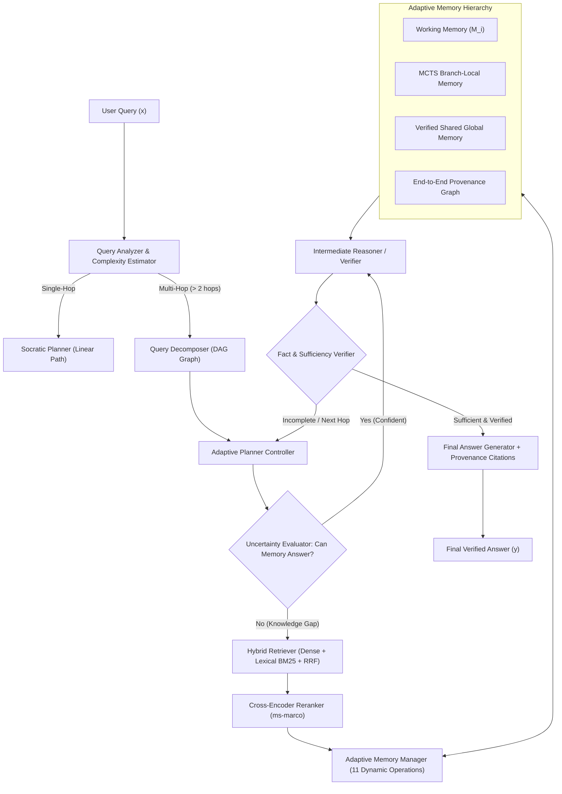

# Adaptive State-Aware Multi-Hop RAG: System Architecture

## 1. Overview & Research Positioning

**Adaptive State-Aware Multi-Hop RAG** transforms retrieval-augmented generation from passive, static context accumulation into a **dynamic, memory-controlled cognitive workspace**. 

While traditional multi-hop systems suffer from *context rot*, *noise accumulation*, and *contradiction compounding*, this architecture employs an active **Adaptive Memory Manager** as the central controller between retrieval and reasoning.

---

## 2. Global Architecture Diagram

---

## 3. Core Architectural Components

### A. State Model ($S_i$)
At any reasoning hop $i$, the cognitive state is formalized as:
$$S_i = \langle x, q_i, r_i, M_i, E_i, U_i, C_i, P_i, \text{Step}_i \rangle$$
* $x$: Global question
* $q_i$: Current atomic sub-question
* $r_i$: Intermediate sub-answer
* $M_i$: Active Working Memory (structured, scored, and de-duplicated)
* $E_i$: Raw & reranked candidate evidence
* $U_i$: Unresolved question dependency queue
* $C_i$: Detected contradictions & resolution audit trail
* $P_i$: Provenance links connecting claims to chunk IDs and ranks
* $\text{Step}_i$: Reasoning step count and remaining budget

### B. Adaptive Memory Controller
Unlike naive pipelines that append text chunks verbatim, the Memory Manager actively chooses among **11 distinct operations**:
1. `ADD`: Register high-relevance atomic claim with provenance.
2. `UPDATE`: Increment access count and adjust confidence.
3. `MERGE`: Synthesize duplicate/overlapping facts, uniting provenance records.
4. `DELETE`: Evict low-utility or refuted items.
5. `RETAIN`: Prioritize critical intermediate facts.
6. `DOWNWEIGHT`: Decay importance of stale items across elapsed hops.
7. `VERIFY`: Mark claims as verified post-reflection.
8. `MARK_CONTRADICTION`: Flag conflicting facts between memory and new evidence.
9. `RESOLVE_CONTRADICTION`: Resolve conflicts by evidence strength and reliability.
10. `SUMMARIZE`: Generate compact memory representation.
11. `CONSOLIDATE`: Run post-hop deduplication, re-scoring, and capacity enforcement.

---

## 4. Multi-Objective Memory Retention Formula

$$\text{Score}(m) = \alpha \cdot \text{Rel} + \beta \cdot \text{Relb} + \gamma \cdot \text{Nov} + \delta \cdot \text{FutUtil} + \epsilon \cdot \text{EvStr} + \zeta \cdot \text{Verif} - \eta \cdot \text{Red} - \theta \cdot \text{ConfRisk} - \lambda \cdot \text{AgeDecay}$$

* All weights ($\alpha, \beta, \gamma, \delta, \epsilon, \zeta, \eta, \theta, \lambda$) are dynamically configurable via [`config.py`](file:///C:/Users/Teja/OneDrive/MS%20office/Working/Capstone/MultiHop_Rag/backend/app/core/config.py).
