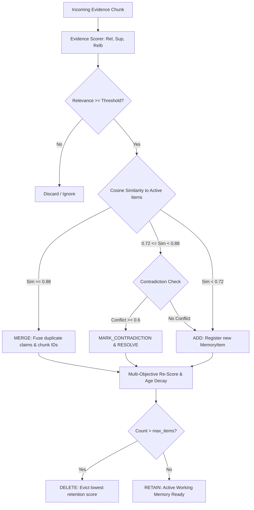

# Adaptive Memory Management: Deep Dive & Algorithm Specification

## 1. The Dynamic Working Memory Concept

Traditional Retrieval-Augmented Generation treats memory as a passive document buffer (`memory = []`). In contrast, **Adaptive State-Aware RAG** implements memory as an actively curated, structured knowledge state where every memory item is a first-class object with quantifiable properties:

```python
class MemoryItem:
    id: str
    content: str
    source_chunk_ids: List[str]
    provenance: List[Provenance]
    hop: int
    confidence: float
    relevance_score: float
    evidence_strength: float
    reliability: float
    novelty_score: float
    redundancy_score: float
    retention_score: float
    contradiction_status: str  # NONE, DETECTED, RESOLVED
    verification_status: str   # UNVERIFIED, VERIFIED, REFUTED
    status: MemoryStatus       # ACTIVE, UNCERTAIN, CONTRADICTED, VERIFIED, DISCARDED
```

---

## 2. The 11 Dynamic Memory Operations



---

## 3. Contradiction Resolution Strategy

When evidence chunks present conflicting factual assertions (e.g., entity birthplace, date, or event outcome):
1. **Detection**: Gated by semantic similarity $\ge 0.72$ to prevent unnecessary LLM calls, followed by pairwise factual contradiction detection.
2. **Flagging**: Both items are flagged with `contradiction_status = "DETECTED"`.
3. **Resolution**: The system evaluates relative evidence strength, source reliability, and verification status. The superior assertion is preserved as `ACTIVE`, while the conflicting claim is flagged as `CONTRADICTED` with full provenance retained for transparency.

---

## 4. Branch vs. Global Memory Isolation in MCTS

```
                    Global Shared Memory (Verified Only)
                          ▲               ▲
             Promote Only │               │ Promote Only
             If Conf >= 0.80             If Conf >= 0.80
                          │               │
                    ┌─────┴─────┐   ┌─────┴─────┐
                    │ Branch A  │   │ Branch B  │
                    │ Local Mem │   │ Local Mem │
                    └───────────┘   └───────────┘
```

* **Branch Isolation**: Speculative reasoning steps in MCTS rollouts only update branch-local memory.
* **Global Promotion**: Only verified, non-contradictory claims exceeding confidence threshold $0.80$ are promoted to the shared global memory, ensuring cross-branch knowledge transfer without noisy pollution.
