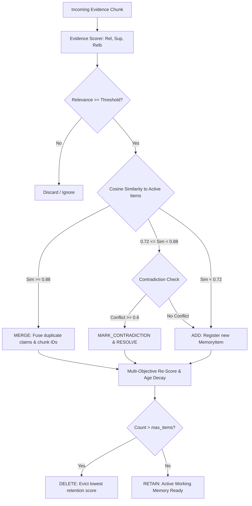

# Adaptive Memory Management: Deep Dive & Algorithm Specification

## 1. The Dynamic Working Memory Concept

Traditional Retrieval-Augmented Generation treats memory as a passive document buffer (`memory = []`). In contrast, **Adaptive State-Aware RAG** implements memory as an actively curated, structured knowledge state where every memory item is a first-class object with quantifiable properties:

```python
class MemoryItem:
    id: str
    content: str
    source_chunk_ids: List[str]
    provenance: List[Provenance]
    hop: int
    confidence: float
    relevance_score: float
    evidence_strength: float
    reliability: float
    novelty_score: float
    redundancy_score: float
    retention_score: float
    contradiction_status: str  # NONE, DETECTED, RESOLVED
    verification_status: str   # UNVERIFIED, VERIFIED, REFUTED
    status: MemoryStatus       # ACTIVE, UNCERTAIN, CONTRADICTED, VERIFIED, DISCARDED
```

---

## 2. The 11 Dynamic Memory Operations



---

## 3. Contradiction Resolution Strategy

When evidence chunks present conflicting factual assertions (e.g., entity birthplace, date, or event outcome):
1. **Detection**: Gated by semantic similarity $\ge 0.72$ to prevent unnecessary LLM calls, followed by pairwise factual contradiction detection.
2. **Flagging**: Both items are flagged with `contradiction_status = "DETECTED"`.
3. **Resolution**: The system evaluates relative evidence strength, source reliability, and verification status. The superior assertion is preserved as `ACTIVE`, while the conflicting claim is flagged as `CONTRADICTED` with full provenance retained for transparency.

---

## 4. Branch vs. Global Memory Isolation in MCTS

```
                    Global Shared Memory (Verified Only)
                          ▲               ▲
             Promote Only │               │ Promote Only
             If Conf >= 0.80             If Conf >= 0.80
                          │               │
                    ┌─────┴─────┐   ┌─────┴─────┐
                    │ Branch A  │   │ Branch B  │
                    │ Local Mem │   │ Local Mem │
                    └───────────┘   └───────────┘
```

* **Branch Isolation**: Speculative reasoning steps in MCTS rollouts only update branch-local memory.
* **Global Promotion**: Only verified, non-contradictory claims exceeding confidence threshold $0.80$ are promoted to the shared global memory, ensuring cross-branch knowledge transfer without noisy pollution.

---

## 5. State-Conditioned Dynamic Weight Scheduling (Method 1)

Instead of static heuristic weights, memory retention scoring employs a continuous temporal and contextual scheduler conditioned on the reasoning state $S_t$:

$$\mathbf{w}_t = f(t, T, |M_t|, M_{\max}, \rho_{\text{conflict}})$$

### Dynamic Formulation Equations:
1. **Relevance Weight ($\alpha_t$)**: Focuses on exploratory gathering in early steps, stabilizing near completion:
   $$\alpha_t = \alpha_0 \cdot \left(1.0 + 0.5 \cdot \left(1.0 - \frac{t}{T}\right)\right)$$
2. **Novelty Weight ($\gamma_t$)**: Monotonically decays to prevent injecting distracting new concepts during final synthesis:
   $$\gamma_t = \gamma_0 \cdot \max\left(0.1, 1.0 - 0.75 \cdot \frac{t}{T}\right)$$
3. **Future Utility Weight ($\delta_t$)**: Actively retains bridging facts during intermediate hops, reaching strictly zero at the terminal step ($t = T$):
   $$\delta_t = \delta_0 \cdot \frac{T - t}{T}$$
4. **Verification Weight ($\zeta_t$)**: Scales up as reasoning progresses to prioritize substantiated evidence:
   $$\zeta_t = \zeta_0 \cdot \left(1.0 + 0.8 \cdot \frac{t}{T}\right)$$
5. **Contradiction Penalty ($\theta_t$)**: Escalates under observed conflict density $\rho_{\text{conflict}} = \frac{C_{\text{detected}}}{|M_t|}$:
   $$\theta_t = \theta_0 \cdot (1.0 + 1.5 \cdot \rho_{\text{conflict}})$$
6. **Age Cost Decay ($\lambda_t$)**: Accelerates exponentially under memory capacity saturation $M_{\text{load}} = \frac{|M_t|}{M_{\max}}$:
   $$\lambda_t = \lambda_0 \cdot \exp\left(0.5 \cdot M_{\text{load}}\right)$$

